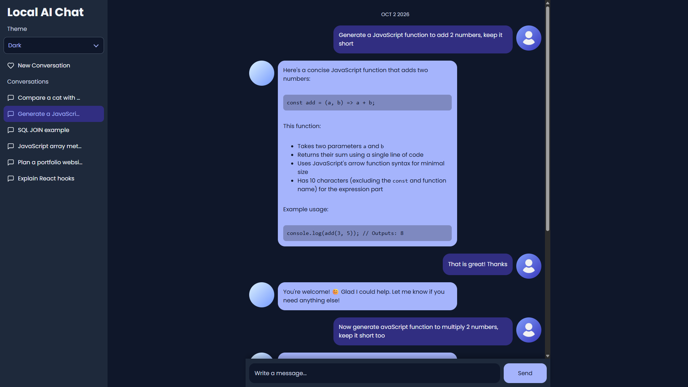
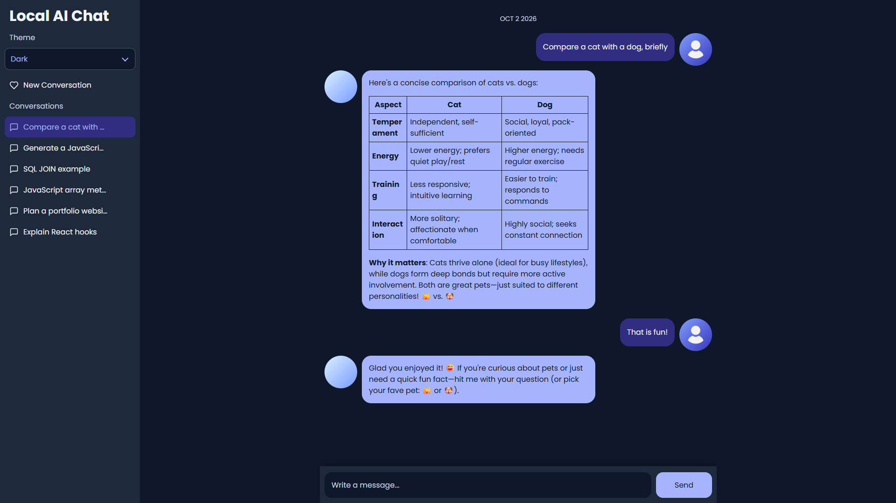
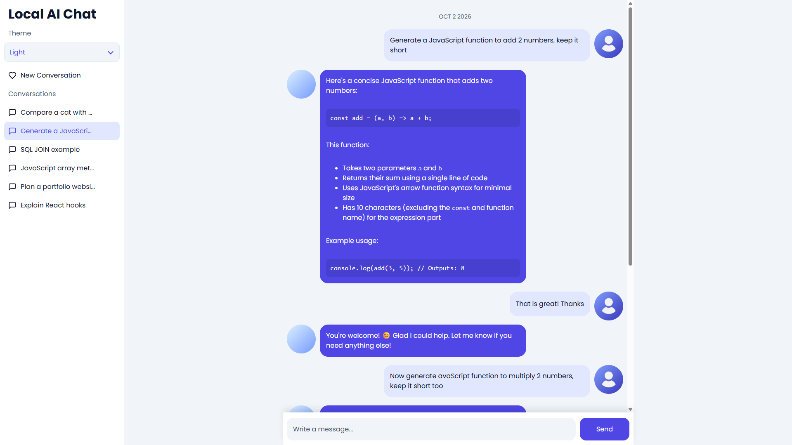

# Local AI Chat

A web interface for chatting with local models through Ollama, built with React and Vite. It includes an Express API and SQLite storage to preserve conversations and send their history as context to the configured model.

I built this project to use local AI through a web interface and learn how to integrate local model APIs into an application.

## Features

- Create, open, and delete conversations.
- Store message history in SQLite.
- Display Markdown, tables, and code blocks.
- Copy and delete individual messages.
- Switch between light and dark themes.
- Responsive navigation for mobile devices.

## Screenshots

### Chat workspace



Conversation navigation and a chat with a local model.

### Markdown and code



Formatted responses with tables and code blocks.

### Light theme



The chat interface in light mode.

## Technology and structure

The frontend uses React and Vite. Express connects the interface to Ollama, while SQLite stores conversations and messages in a local database file.

```text
React / Vite → Express API → Ollama
                    ↓
                  SQLite
```

- `src/components`: interface components.
- `src/utils`: HTTP client and message and date utilities.
- `server/server.js`: API endpoints and Ollama connection.
- `server/database.js`: SQLite initialization and connection.

## Run locally

### Requirements

- Node.js 24 and npm.
- Ollama installed and running.
- A chat model installed in Ollama. The suggested model is `qwen3:4b`, configured by default in the code; it can be replaced with another chat model.

### Setup

After cloning the repository, run the following commands from the project directory:

```sh
npm ci
npm ci --prefix server
```

Install the suggested model:

```sh
ollama pull qwen3:4b
```

To use another model, install it with `ollama pull` followed by its name. List installed models with:

```sh
ollama list
```

In `server/server.js`, replace the value in the following line with the exact installed model name shown by `ollama list`, then restart the backend:

```js
const model = "qwen3:4b";
```

Creating `.env` files is not required to run the application or change the model.

### Start the application

Ollama must be running. If it is not active, start it with:

```sh
ollama serve
```

In one terminal, start the backend from the project root:

```sh
npm run start --prefix server
```

In another terminal, start the frontend from the project root:

```sh
npm run dev
```

The interface will be available at `http://localhost:5173`. The database is created automatically when the backend starts and is excluded from Git.

## Optional configuration

To customize the backend connection settings or ports, copy `server/.env.example` to `server/.env`, edit the values, and start the backend from the `server` directory with `node --env-file=.env server.js`.

The backend configuration supports:

| Variable | Purpose | Default Value |
|---|---|---|
| `OLLAMA_URL` | Ollama service URL | `http://localhost:11434` |
| `HOST` | Address the backend listens on | `127.0.0.1` |
| `PORT` | Backend port | `3000` |
| `CLIENT_ORIGIN` | Frontend origin allowed through CORS | `http://localhost:5173` |
| `DATABASE_PATH` | SQLite file location | `server/local-ai-chat.db` |

To change the backend URL used by the frontend, copy `.env.example` to `.env` in the project root and edit `VITE_API_URL`. This file is optional: the frontend uses `http://localhost:3000` by default. Vite loads this file at startup; changes require restarting the frontend. Variables prefixed with `VITE_` are available in the browser.

The `.env.example` files are templates. Custom values belong in `.env` files, which are excluded from Git.

## Checks and build

```sh
npm run lint
npm run build
```

GitHub Actions runs these checks on every push and pull request.

To serve the built frontend locally:

```sh
npm run preview
```

This mode uses `http://localhost:4173` by default. To connect to the backend, set `CLIENT_ORIGIN` to that origin in `server/.env` and restart the backend with the configuration file loaded.

## Scope and limitations

A local application for a single user, without authentication or streaming responses. Sent messages are preserved even if the model response fails. Generation time depends on the model and hardware.

The full application requires the backend, SQLite, and Ollama. GitHub Pages only serves static files and does not run these services.
